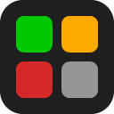

<p align="center"></p>

# KeyGlow

See your Wordle progress on your real keyboard. As you play, the letter keys on your RGB keyboard light up like the game's on-screen keyboard:

| Key colour | Meaning |
| --- | --- |
| Green | Right letter, right spot |
| Yellow | In the word, wrong spot |
| Red | Not in the word |
| Dim white | Not tried yet |

When you close the game, your keyboard goes back to its normal lighting.

KeyGlow is free and open source. It is not affiliated with The New York Times. Wordle is a trademark of The New York Times Company.

## What you need

- A keyboard with per-key RGB lighting from the [supported list](#supported-keyboards), connected by USB cable.
- [Node.js](https://nodejs.org) 20 or later. This runs the small companion app that talks to the keyboard.
- Microsoft Edge, Google Chrome, or another Chromium browser.

## Install

### 1. Start the companion app

Open a terminal (PowerShell on Windows) and run:

```
npx keyglow test
```

On your keyboard, A should turn green, B yellow, C red, and the other letters dim white. Press Ctrl+C to put your lighting back.

Then start it for real, and leave the window open while you play:

```
npx keyglow
```

### 2. Add the browser extension

**Edge:** install KeyGlow from Edge Add-ons (link coming once the listing is approved).

**Chrome and other browsers:**

1. Download `keyglow-extension-<version>.zip` from the [latest release](https://github.com/aadilshaikh123/keyglow/releases/latest) and unzip it.
2. Open `chrome://extensions` and turn on **Developer mode** (top right).
3. Click **Load unpacked** and pick the unzipped folder.

Chrome will remind you that a developer-mode extension is installed. That is expected. Unpacked extensions do not update themselves, so download the new zip when a new version comes out.

### 3. Play

Open [Wordle](https://www.nytimes.com/games/wordle/index.html) and play as usual. Click the KeyGlow icon to check that the companion, keyboard and game are all connected.

## Supported keyboards

| Keyboard | How | Notes |
| --- | --- | --- |
| URX Core65 | Direct USB, nothing else to install | Tested. Close the URX Hub web driver while playing. |
| Keyboards supported by [OpenRGB](https://openrgb.org) | Through OpenRGB | Start OpenRGB and its SDK Server first. Not yet tested on real hardware; reports welcome. |

Want your keyboard supported? See [Adding a keyboard](#adding-a-keyboard).

## Options

```
npx keyglow [run|test] [options]

  --backend <name>      auto (default), urx, openrgb, mock
  --port <number>       Port to listen on (default 47652)
  --high-contrast       Orange and blue, like the game's high-contrast mode
  --colors <list>       Override colours, e.g. absent=400000,unused=303030
  --extension-id <id>   Only accept requests from this extension ID
```

`--colors` accepts `correct`, `present`, `absent` and `unused`, each with a 6-digit hex colour.

## Troubleshooting

- **Popup says the companion is not running.** Start `npx keyglow` and keep its window open.
- **Popup says the keyboard is not connected.** Use a USB cable rather than wireless, and close other lighting software (URX Hub, OpenRGB if you use the direct backend).
- **Keys stay on game colours after the companion was closed.** Run `npx keyglow test` and press Ctrl+C. It puts your saved lighting back.

## Privacy

The extension only reads the on-screen keyboard on Wordle and sends it to the companion on your own computer. Nothing leaves your machine. See [PRIVACY.md](PRIVACY.md).

## Adding a keyboard

The companion has a small backend interface (`packages/companion/src/backends/backend.ts`):

- connect to the keyboard;
- set a colour per letter;
- restore the original lighting.

For boards that speak the same protocol as the URX Core65, adding one is a single entry in `LETTER_ROW_STARTS` in `rdm-protocol.ts`: the light index of Q, A and Z. `scripts/hid-list.mjs` shows whether your board exposes the same USB interface.

Open an issue with your keyboard's name and the output of `node scripts/hid-list.mjs`, or send a pull request.

## Development

Requires Node 20+ and pnpm.

```
pnpm install
pnpm build     # builds all packages
pnpm test      # companion unit tests
```

| Package | Contents |
| --- | --- |
| `packages/protocol` | Message types shared by the extension and companion |
| `packages/companion` | The `keyglow` npm package and keyboard backends |
| `packages/extension` | The browser extension. Load `packages/extension/dist` unpacked to try it. |

To support another word game, add an adapter in `packages/extension/src/adapters.ts` and a match pattern in `static/manifest.json`.

## License

[MIT](LICENSE)
